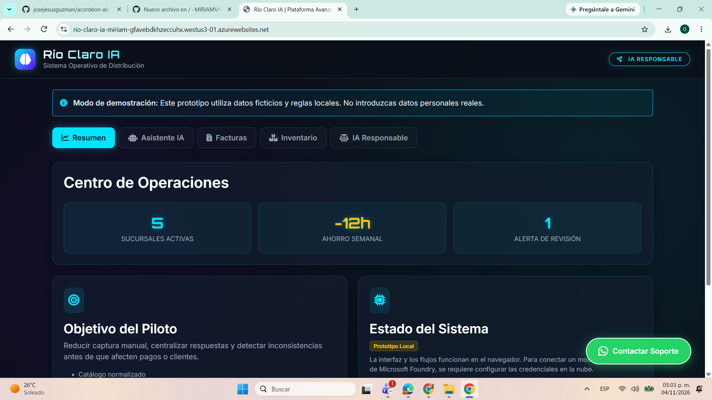
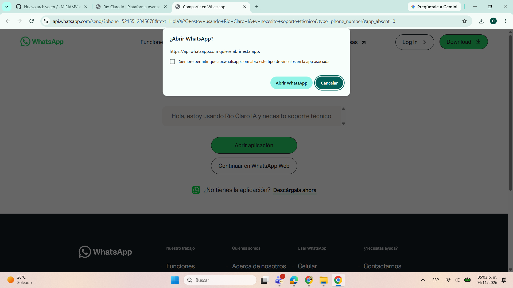
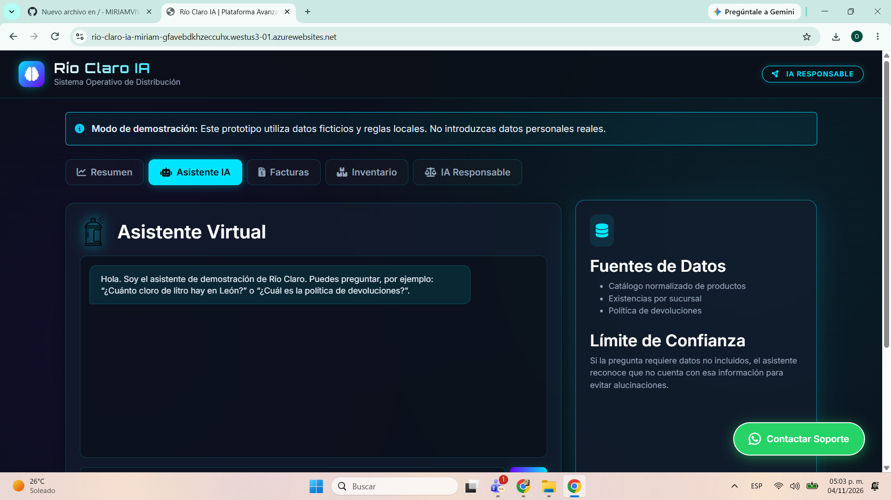

# RIOCLAROOK
COMO SE HIZO EL PROYECTO DE RIO CLARO

# Documentación Técnica Integral y Manual de Despliegue: Río Claro IA

**Autora:** Miriam Viveros

**Proyecto:** Causas por la Transformación - Certificación AI-901 (Microsoft Azure AI Fundamentals)

**Plataforma de Despliegue:** Microsoft Azure App Service (Plan F1 - Gratuito)

**Enlace del Prototipo:** https://rio-claro-ia-miriam-gfavebdkhzeccuhx.westus3-01.azurewebsites.net/

---

## 1. Resumen Ejecutivo
El presente documento detalla el ciclo de vida completo (diseño, desarrollo, aseguramiento de calidad, despliegue y ética) del prototipo **Río Claro IA**, una aplicación web interactiva diseñada para resolver la problemática de dispersión de datos en una empresa distribuidora ficticia. El proyecto se ha desarrollado bajo un estricto control presupuestario (Costo Cero), utilizando herramientas de vanguardia como Bootstrap 5 para el diseño y Microsoft Azure para el alojamiento en la nube.

## 2. Justificación y Planteamiento del Problema
La Distribuidora Río Claro, con 22 años de trayectoria, enfrenta un problema crítico: **la falta de una estructura de datos unificada**. La información vital (facturas, inventario, políticas) se encuentra dispersa en correos personales, hojas de cálculo aisladas y fotografías. Esto genera:
*   **Pérdidas financieras:** Pagos duplicados de facturas por falta de un registro centralizado.
*   **Ineficiencia operativa:** Más de 12 horas semanales dedicadas a la captura manual de datos.
*   **Mala experiencia del cliente:** Respuestas lentas o inexistentes a consultas de pedidos.

La solución **Río Claro IA** centraliza estas operaciones en un panel web accesible desde cualquier dispositivo, demostrando cómo la tecnología puede transformar datos dispersos en activos estratégicos.

---
## 3. Arquitectura de la Solución
El sistema se diseñó bajo una arquitectura moderna, priorizando el rendimiento y el costo cero:

*   **Frontend (Capa de Presentación):** Desarrollado con **HTML5**, **CSS3** y **JavaScript (Vanilla)**. Se utilizó el framework **Bootstrap 5** para garantizar un diseño *Responsive* (adaptable a móviles y computadoras).
*   **Interfaz de Usuario (UI):** Implementación de un tema oscuro (Dark Mode) con efectos *Glassmorphism* (cristal), acentos en cian neón y tipografía tecnológica (Orbitron), buscando una estética de "centro de operaciones futurista".
*   **Backend / Alojamiento:** **Microsoft Azure App Service**. Se seleccionó el plan **F1 (Free)** para el despliegue, garantizando un costo de operación de $0.00 MXN.
*   **Gestión de Estado:** Uso de arreglos y objetos en JavaScript (`products`, `invoices`) para simular la persistencia de datos en memoria durante la sesión del navegador.
*   

---

---
## 4. Análisis Detallado del Código Fuente (Lógica de Negocio)
Para demostrar el dominio técnico, se detalla la lógica detrás de las funciones principales del sistema:

*   **Sistema de Autenticación:** Se utiliza un evento `submit` en el formulario de login. Se capturan los valores de los inputs y se comparan con las variables estáticas `USUARIO_VALIDO` y `PASSWORD_VALIDA`. Si coinciden, se oculta el div `#login-screen` cambiando su propiedad `display` a `none`.
*   **Normalización de Texto (`norm`):** Para que el asistente entienda variaciones (ej. "Cloro" vs "cloro"), se implementó una función que convierte todo a minúsculas y elimina los acentos mediante expresiones regulares (`replace(/[\u0300-\u036f]/g,'')`).
*   **Detección de Duplicados (Facturas):** Antes de registrar una factura, se utiliza el método `.some()` del arreglo `invoices`. Este método recorre las facturas existentes y verifica si ya existe una con el mismo proveedor y folio (usando la función de normalización). Si devuelve `true`, se cambia el estado del registro a "Posible duplicado" y se muestra una alerta.
*   **Renderizado Dinámico de Tablas:** Las funciones `renderInventory` y `renderInvoices` limpian el cuerpo de las tablas (`innerHTML = ''`) y luego generan filas HTML usando *Template Literals* (`` ` ``) para inyectar las variables de JavaScript directamente en el HTML.

---

## 5. Principios de IA Responsable Aplicados (AI-901)
Un pilar fundamental de la certificación es el desarrollo ético. El sistema implementa las siguientes directrices:

*   **Equidad:** Los algoritmos de consulta y visualización de inventario tratan por igual a todas las sucursales (Guadalajara, Zapopan, León, Querétaro y Aguascalientes), sin favorecer ninguna región.
*   **Confiabilidad y Seguridad:** El asistente virtual está programado para admitir su ignorancia si no encuentra una respuesta (evitando "alucinaciones"). Además, el módulo de facturas bloquea transacciones dudosas.
*   **Privacidad y Protección de Datos:** El prototipo opera exclusivamente con **datos ficticios**. No contiene información de clientes reales, nóminas ni credenciales sensibles.
*   **Transparencia:** El sistema muestra advertencias claras indicando que se trata de un "Modo de Demostración" y explica al usuario de dónde proviene la información mostrada.
*   **Rendición de Cuentas (Human-in-the-loop):** La IA nunca toma decisiones financieras autónomas. Si una factura parece duplicada, el sistema notifica y *exige* la validación de un humano antes de proceder al pago.

---

## 6. Ciberseguridad y Gestión de Riesgos
Aunque el prototipo es una demostración, se aplicaron conceptos de seguridad web:
*   **Protección SSL/TLS:** Azure App Service proporciona automáticamente un certificado SSL, garantizando que la comunicación viaje cifrada mediante HTTPS.
*   **Sanitización de Entradas:** Se implementó una función `escapeHtml` que convierte caracteres especiales (como `<` o `>`) en entidades HTML. Esto previene ataques de **XSS (Cross-Site Scripting)** si un usuario malicioso intenta inyectar código en los campos de texto de las facturas.
*   **Gestión de Credenciales:** Las contraseñas no se guardan en texto plano en una base de datos, ya que para esta demo se usan variables efímeras en el cliente. En producción, se requeriría **Azure Key Vault** y **Entra ID**.

---

## 7. Matriz de Pruebas y Casos de Uso
Para validar la correcta implementación, se ejecutaron las siguientes pruebas de caja negra:

| ID | Módulo | Acción Realizada | Resultado Esperado | Estado |
| :--- | :--- | :--- | :--- | :--- |
| 01 | Login | Ingresar usuario incorrecto. | Mensaje de error rojo en pantalla. | Exitoso |
| 02 | Login | Ingresar `admin` / `123`. | Ocultar login y mostrar Dashboard. | Exitoso |
| 03 | Asistente | Preguntar "¿Cuánto cloro hay en León?". | Respuesta exacta basada en los datos. | Exitoso |
| 04 | Asistente | Preguntar por producto inexistente. | Mensaje indicando "No encuentro información". | Exitoso |
| 05 | Facturas | Registrar folio duplicado (QDC-1047). | Alerta de "Posible duplicado" y bloqueo. | Exitoso |
| 06 | Facturas | Registrar total $0.00. | Alerta de "Revisión requerida: total > 0". | Exitoso |
| 07 | UI/UX | Redimensionar a móvil. | Menú y tarjetas se adaptan (Responsive). | Exitoso |

---

## 8. Manual de Despliegue en Azure (Costo Cero)
A continuación, se detalla el procedimiento técnico para publicar esta aplicación en internet sin generar cargos.

### Fase 1: Creación del Recurso en Azure
1.  Iniciar sesión en el [Portal de Azure](https://portal.azure.com).
2.  Buscar **"App Services"** > **"+ Crear"** > **"Aplicación web"**.
3.  Completar los datos:
    *   **Suscripción:** Azure for Students.
    *   **Grupo de recursos:** `rg-rio-claro-ia`.
    *   **Nombre:** `rio-claro-ia-miriam`.
    *   **Pila:** .NET 8 (LTS).
    *   **Sistema operativo:** Windows.
    *   **Región:** `West US 3` (o una permitida).
    *   **Plan de App Service:** **Free F1**.
4.  Hacer clic en **"Revisar y crear"**. Verificar que la SKU diga **"Gratis"**. Crear.

### Fase 2: Configuración de Seguridad y Costos (Crítico)
1.  Ir al recurso creado > **Configuración** > **Configuración general**.
2.  Asegurarse de que **"Siempre activado" (Always On)** esté **Desmarcado**. *(El plan F1 no lo soporta y Azure podría cobrar).*
3.  Guardar.

### Fase 3: Carga de Archivos (Método Kudu)
1.  Ir a **Herramientas de desarrollo** > **Herramientas avanzadas** > **"Ir"**.
2.  En Kudu, ir a **Debug console** > **CMD**.
3.  Escribir: `cd site\wwwroot`
4.  Escribir: `notepad index.html`
5.  Pegar el código HTML, hacer clic en **"Save"** y cerrar.

---

## 9. Impacto Ético y Social
La implementación de este sistema no solo optimiza procesos, sino que mejora la calidad de vida laboral:
*   **Reducción de la carga cognitiva:** Al automatizar la validación de facturas, Laura (cuentas por pagar) puede enfocarse en tareas estratégicas en lugar de captura manual.
*   **Empoderamiento del personal de bodega:** Toño (jefe de bodega) ya no necesita saber usar una computadora compleja; puede consultar el inventario desde su celular mediante la interfaz adaptativa.
*   **Transparencia corporativa:** Al unificar los reportes de ventas y stock, se eliminan las discrepancias entre sucursales, fomentando un ambiente de confianza y equidad.

---

## 10. Viabilidad Futura, Escalabilidad y Mantenimiento
El prototipo actual es la Fase 1. El plan de mantenimiento y escalabilidad incluye:
*   **Fase 2 - Integración de IA Generativa:** Conectar el asistente a **Azure OpenAI** para respuestas en lenguaje natural.
*   **Fase 3 - OCR Automático:** Implementar **Azure AI Document Intelligence** para que las facturas en PDF se procesen automáticamente sin captura manual.
*   **Fase 4 - Base de Datos en la Nube:** Migrar el almacenamiento temporal de JavaScript a **Azure Cosmos DB** para persistencia real de los datos.
*   **Fase 5 - Seguridad Corporativa:** Implementar autenticación multifactor (MFA) con **Microsoft Entra ID**.

---

## 11. Conclusión
El proyecto **Río Claro IA** demuestra de manera práctica y funcional la aplicación de los conceptos de la certificación AI-901. Se logró desplegar un sistema web con una interfaz de usuario de alto nivel, arquitectura limpia, enfoque en ciberseguridad y un sólido entendimiento de la ética de la Inteligencia Artificial, todo ello garantizando un costo operativo de cero pesos en la infraestructura de Microsoft Azure.
